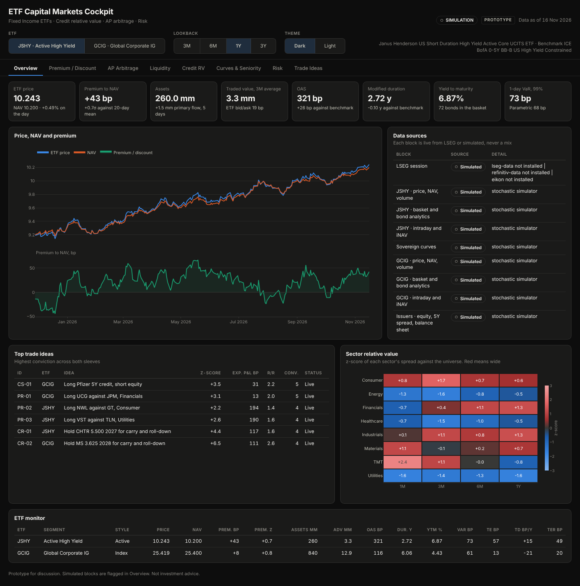
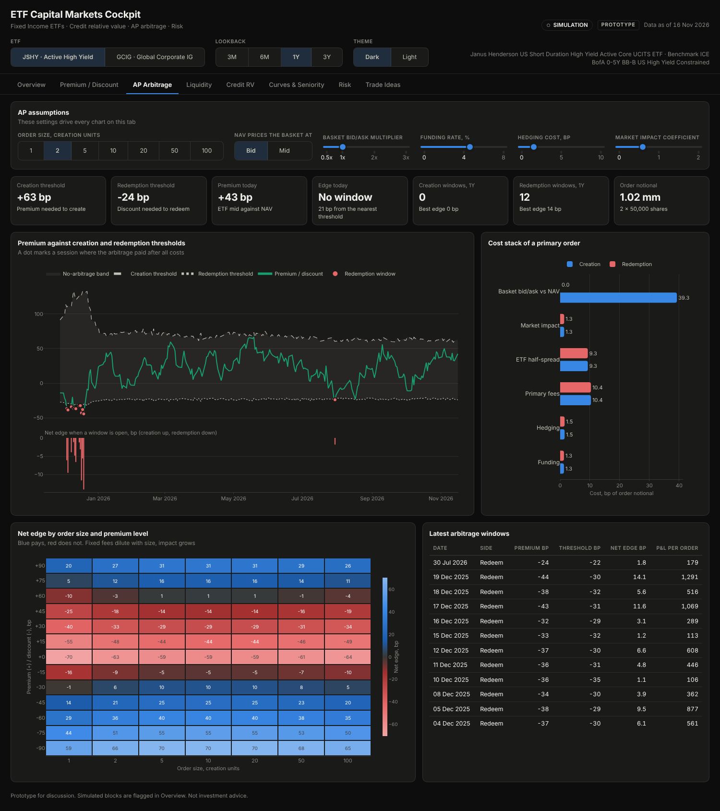
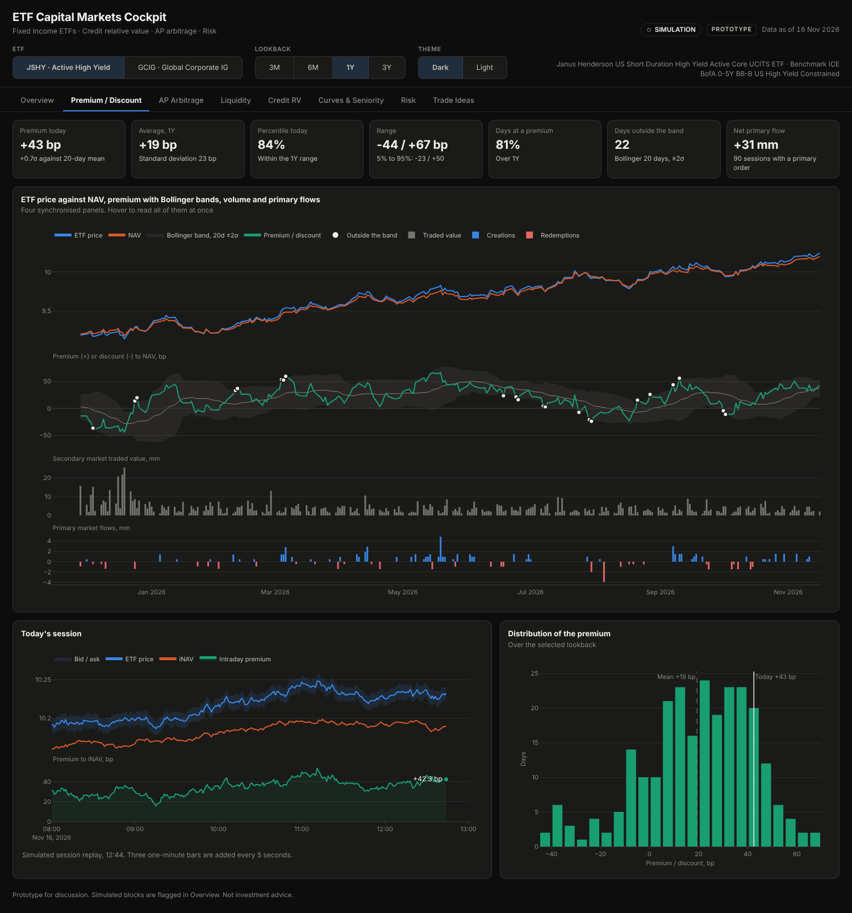
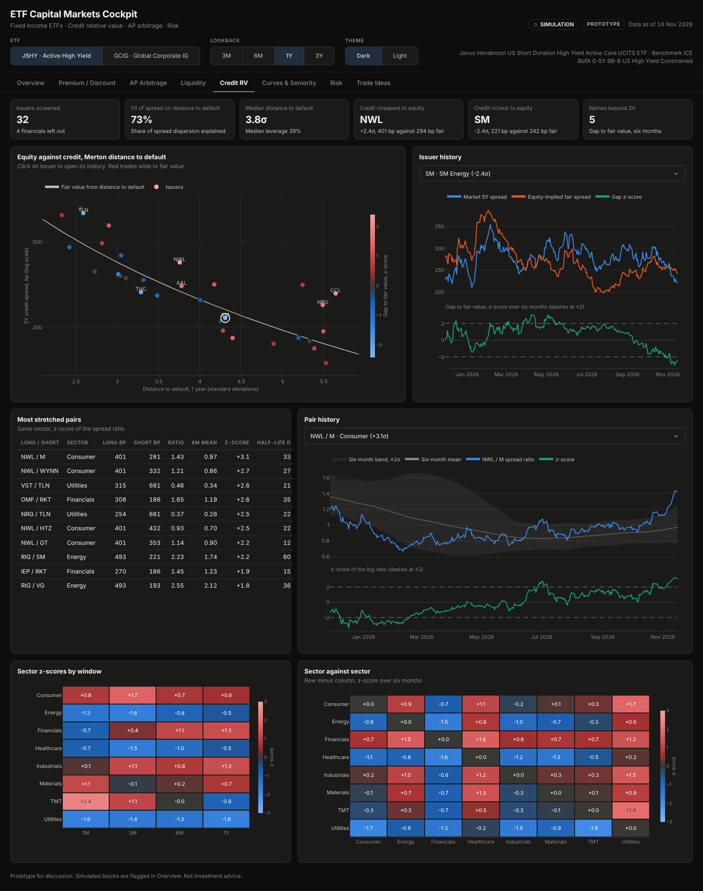
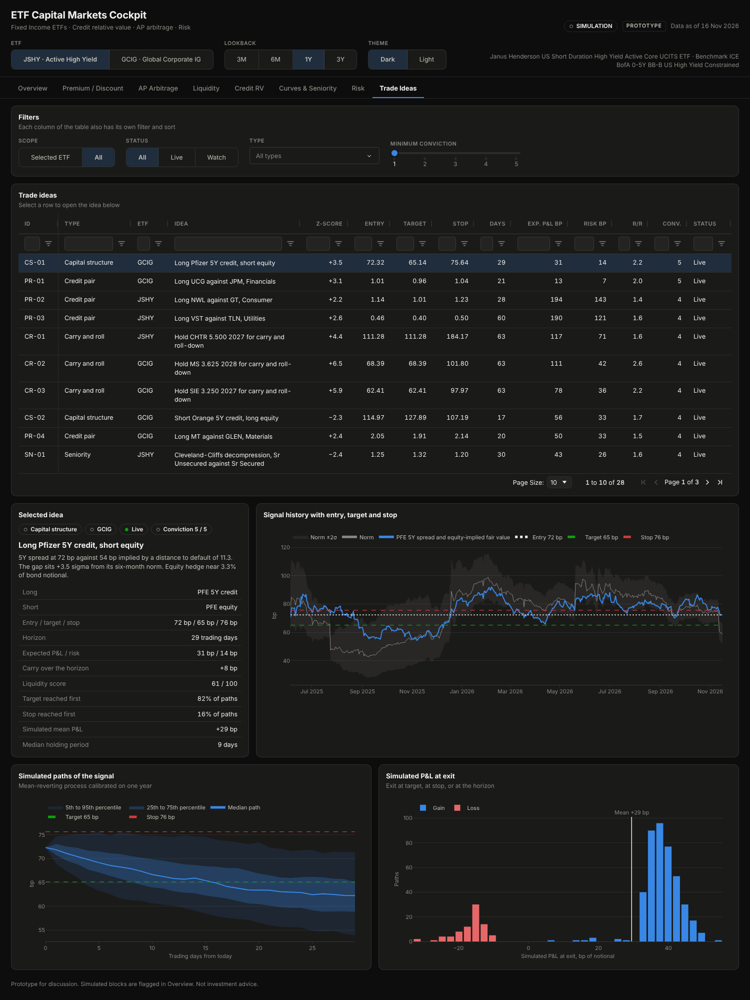

# ETF Capital Markets Cockpit


A dashboard for a fixed income ETF desk. It follows a bond ETF from both sides of the wrapper, the shares that trade on screen and the basket of bonds behind them, and it answers the questions a Product and Capital Markets team asks every day. Is the premium normal? Can an Authorized Participant make money creating or redeeming? Is the basket liquid enough for the order? Where is credit cheap? What does the portfolio lose on a bad day?

It runs on LSEG Workspace data when Workspace is open on the machine, and on a built-in market simulator otherwise. So it starts anywhere, and it always says which numbers are live and which are simulated.



| Page | What it answers |
|---|---|
| Overview | Price, NAV, premium, assets, duration and VaR in eight numbers. Where each block of data comes from. The highest conviction ideas |
| Premium / Discount | Is today's premium unusual. Price against NAV, the premium inside its Bollinger bands, traded value and primary flows on one synchronised chart, plus the intraday session against iNAV |
| AP Arbitrage | What premium makes a creation pay and what discount makes a redemption pay, once the basket bid/ask, market impact, fees, hedging and funding are paid for. Net edge by order size |
| Liquidity | Can the basket absorb the order. Each bond by volume, bid/ask and weight, a liquidity score by sector and maturity, and what trades on screen against what the basket can take in a day |
| Credit RV | Where credit is cheap or rich to equity, with a Merton distance to default for each issuer. The most stretched pairs within a sector. Sectors against each other |
| Curves & Seniority | The sovereign curve and its slopes, credit curves by rating, carry and roll-down, and what a subordinated bond pays over the senior one of the same issuer |
| Risk | Historical, parametric and Cornish-Fisher VaR with a backtest. Key rate durations, duration times spread by sector, tracking difference and tracking error, six stress scenarios |
| Trade Ideas | A table to sort and filter. Each idea has an entry, a target, a stop, a horizon and a Monte Carlo simulation of its signal |

The default universe holds one real product and one model sleeve. JSHY is the Janus Henderson US Short Duration High Yield Active Core UCITS ETF, with its RIC, ISIN, TER and benchmark taken from the public product page. GCIG is a model sleeve of global investment grade corporates, to be mapped to a listed ETF in `config.py`.

## Run it

```
pip install -r requirements.txt
python app.py
```

The browser opens on http://127.0.0.1:8050. Without LSEG the app runs on the simulator.

```
python app.py --mode sim                  # simulator only, does not look for LSEG
python app.py --port 8060 --no-browser
pip install -r requirements-dev.txt
pytest -q                                 # 31 tests
```

## How it works

```
app.py                  entry point
config.py               ETF and issuer universes, RICs, LSEG fields, AP cost assumptions
data/
  lseg_client.py        LSEG access through lseg-data, refinitiv-data or eikon
  synthetic.py          market simulator
  provider.py           hybrid provider, falls back to the simulator block by block
  models.py             containers passed from data to engine
engine/
  bondmath.py           price, duration, convexity, Nelson-Siegel
  merton.py             capital structure, distance to default, fair spread
  relative_value.py     pairs, z-scores, half-life, sectors
  etf_analytics.py      premium, AP costs and thresholds, liquidity
  curves.py             rates and credit curves, carry and roll-down, seniority
  risk.py               exposures, VaR, backtest, tracking, stress
  trade_ideas.py        builds and simulates the ideas
  analytics.py          front of the engine, with a cache
ui/                     Dash layout, Plotly figures, one callback per page
scripts/lseg_check.py   says which RICs and fields answer on your licence
tests/                  engine, LSEG path with a fake library, the whole app
```

The engine does not depend on the interface, so it also runs in a notebook.

```python
from data.provider import DataProvider
from engine.analytics import Analytics

an = Analytics(DataProvider(mode="sim"))
an.ideas()                          # the trade ideas table
an.capital_structure()["snap"]      # Merton, issuer by issuer
an.var("JSHY")                      # every VaR measure
```



### Modelling choices worth knowing

- **The AP band is lopsided.** A creation threshold adds up the basket bid/ask, market impact, half the ETF spread, primary fees, hedging and funding. When the NAV prices bonds at the bid, buying the basket costs the whole bid/ask above NAV and selling it costs nothing. That is why bond ETFs sit at a small premium most of the time, and why redemptions open first when the market sells off. The Bid / Mid switch on the page shows it.
- **Market impact.** A square-root model bond by bond, `coeff x daily vol x sqrt(amount / daily volume)`. Small orders pay the fixed fee, large ones pay impact, and the heatmap shows where the two cross.
- **Equity against credit.** Merton is solved for each issuer from market cap, equity volatility and debt, with a KMV-style default point. At each date a cross-section of `ln(spread)` on `ln(1 + DD)` gives the spread each issuer deserves. The signal is the gap to that fair spread, as a z-score over six months. Financials are left out, since deposits make their balance sheet unreadable for this model.
- **Pairs.** Every pair inside a sector is scanned on the log ratio of spreads. A pair becomes an idea when its half-life is short and its Dickey-Fuller statistic says it mean reverts.
- **Credit curves.** One curve per rating bucket, fitted on senior unsecured bonds only so that slope and seniority are not mixed. The seniority premium of an issuer is corrected for the maturity gap between its two bonds.
- **VaR.** Today's portfolio is replayed on past moves in rates and spreads, bond by bond, with duration, convexity and spread duration. The backtest counts the exceptions and runs a Kupiec test.
- **Trade ideas.** The target is only half of the way back to the mean and the stop sits three quarters of a standard deviation the wrong way. The horizon is two half-lives. Both settings are at the top of `engine/trade_ideas.py`.
- **Bonds.** Fixed-rate bullets, so no call options, and spread duration equals modified duration. FX is ignored.

## Data

Each block of data is either live or simulated, never a mix. A real price against a simulated NAV would give a premium that means nothing. The Overview page lists where each block comes from.

| Block | Goes live when | Otherwise |
|---|---|---|
| Sovereign curves, USD and EUR | at least four tenors answer | simulator |
| ETF price, NAV, volume | `ric` is set and both price and NAV come back | simulator |
| Basket and bond analytics | holdings, coupon, maturity and 60 days of spreads cover 70% of the basket | simulator |
| Intraday and iNAV | `inav_ric` is set | panel off |
| Benchmark tracking | `bench_ric` is set | panel off |
| Issuers for Merton | ten 5Y CDS RICs are filled in `config.CDS_RICS` | simulator |

Even on live data, daily volume and bid/ask per bond are modelled, since there is no TRACE feed here, and benchmark weights are approximated by amounts outstanding.

### The simulator

One seed builds a whole market that holds together. A calm or stress regime drives equities, credit and rates. Each issuer's spread follows its own share price the Merton way, plus a mean-reverting noise that creates the relative value signals. Bond spreads are the issuer's spread times a curve slope and a seniority premium. The ETF's NAV comes from its basket, and its premium moves inside a band that Authorized Participants close when it gets too wide.

Issuers carry real names so that their equity RICs are ready for live data. Their ratings, spreads, balance sheets and bond lines are drawn by the simulator. The simulated history runs three years, while JSHY itself was launched in January 2026. Creation unit size and primary fees are illustrative and should be set from the prospectus.

### Public and private

LSEG data is licensed, so none of it goes into this repo. The rule is the same as on my other projects, "Not allowed to share private data to public". Every screenshot here comes from the simulator, and the app key lives in an environment variable or in a `.lseg_app_key` file that is gitignored.

### Plugging in LSEG Workspace

The client goes through the LSEG Data Library in a desktop session, so the data stays on the machine under its licence. It also accepts `refinitiv-data` or `eikon` if one of them is already installed.

```
pip install -r requirements-lseg.txt
setx LSEG_APP_KEY <key from the App Key Generator in Workspace>
python scripts/lseg_check.py              # what each RIC and field returns, nothing written
python app.py
```

The LSEG layer has not been run against a real Workspace session yet. Call signatures were checked on `lseg-data` 2.1.1 and the plumbing is tested with a fake library, but field names in `config.LSEG_FIELDS` depend on the licence. `scripts/lseg_check.py` prints a line for every RIC or field that does not answer.

## More pages







This is a personal project. It is not affiliated with or endorsed by Janus Henderson or LSEG, and nothing in it is investment advice.
